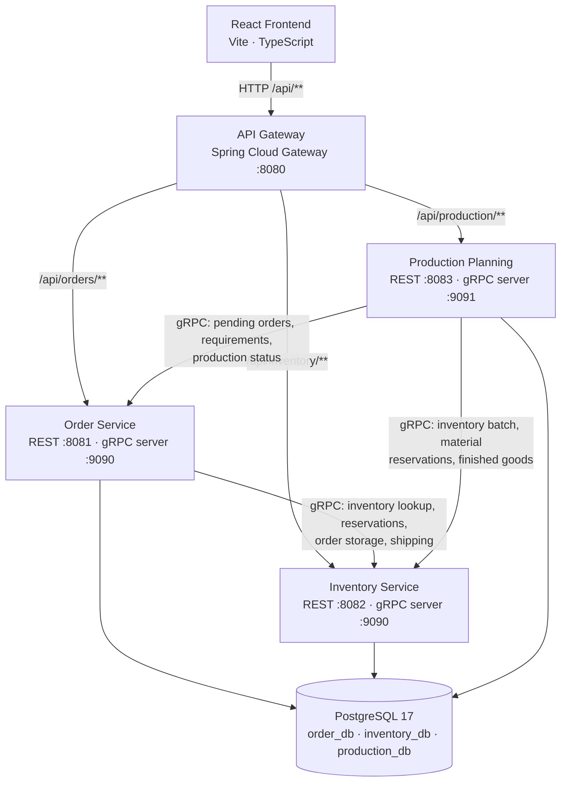
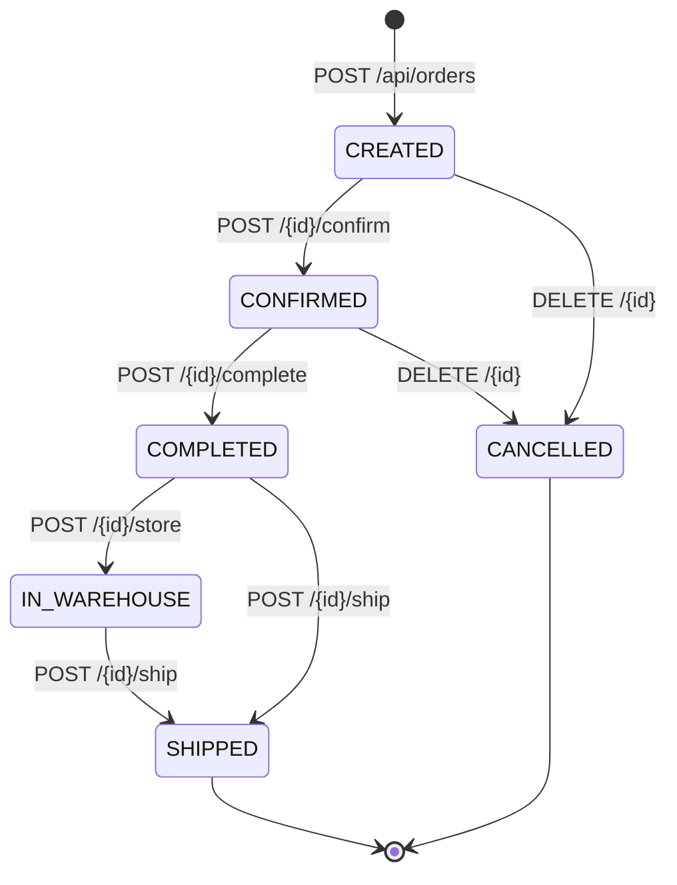
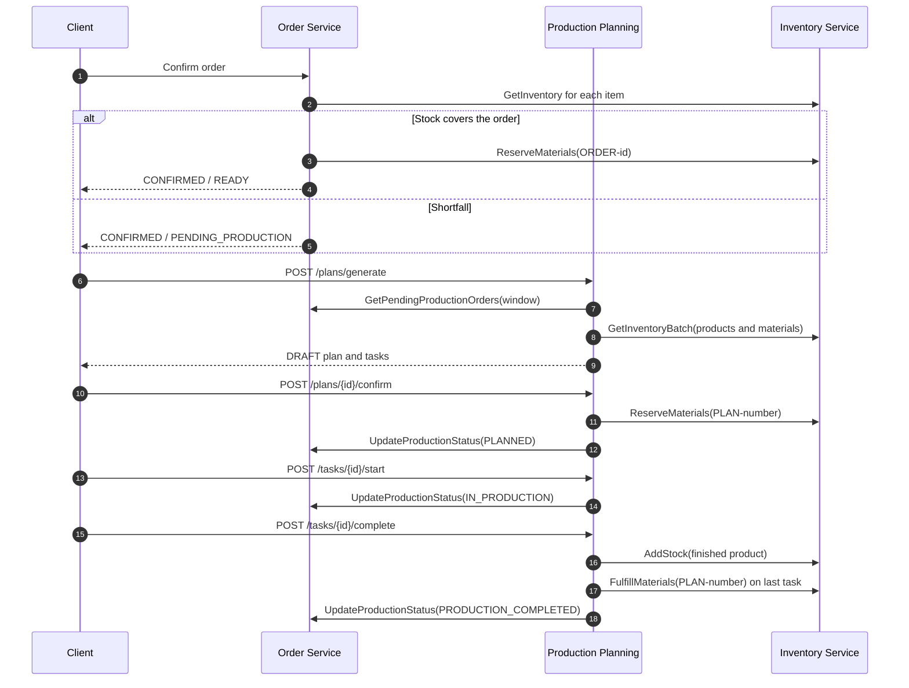

# SmartWareHouse

<p align="center">
  
</p>

<p align="center">
  A microservices warehouse-management platform covering the full order lifecycle:
  order intake, stock reservation, JIT replenishment, production planning, warehouse
  storage, delivery selection and shipping — with a React operations console.
</p>

<p align="center">
  
  
  
  
  
  
  
</p>

---

## Contents

1. [What the system does](#1-what-the-system-does)
2. [Architecture](#2-architecture)
3. [Order lifecycle](#3-order-lifecycle)
4. [Production planning](#4-production-planning)
5. [Inventory, JIT Kanban and warehousing](#5-inventory-jit-kanban-and-warehousing)
6. [Delivery planning](#6-delivery-planning)
7. [Technology stack](#7-technology-stack)
8. [Repository layout](#8-repository-layout)
9. [Getting started](#9-getting-started)
10. [Service endpoints](#10-service-endpoints)
11. [API reference](#11-api-reference)
12. [End-to-end walkthrough](#12-end-to-end-walkthrough)
13. [Demo data](#13-demo-data)
14. [Database design](#14-database-design)
15. [Reliability and concurrency](#15-reliability-and-concurrency)
16. [Testing](#16-testing)
17. [Troubleshooting](#17-troubleshooting)
18. [Current limitations and roadmap](#18-current-limitations-and-roadmap)

---

## 1. What the system does

SmartWareHouse is a containerized warehouse-management example built around four
independently deployable Spring Boot services and a React frontend.

Current capabilities:

- **Order management** — create, confirm, complete, store, ship and cancel customer orders.
- **Stock reservation** — confirmation checks availability and reserves finished goods when stock covers the order; otherwise the order is queued for production.
- **Production planning** — deterministic, line-based scheduling from pending orders, BOMs, working calendar and production-line throughput, with material reservations on plan confirmation.
- **Production execution** — start/complete tasks; completion adds finished goods to inventory and consumes reserved BOM materials.
- **JIT Kanban** — live bin status (healthy, low, reorder, critical, overstock) and one-click replenishment plans up to bin capacity.
- **Warehouse management** — physical sites and storage plots with area, unit capacity, product assignment and plot-to-plot moves.
- **Order storage and shipping** — completed orders can be allocated to plots, then shipped; emergent orders can ship directly from production.
- **Delivery selection** — sea, air and truck quotes with transit time, cost, container/LCL sizing and deadline feasibility.
- **Operations console** — dashboard, orders, delivery, inventory/Kanban, warehouses, production planning, Gantt, BOM and configuration screens.

The project is intended for learning and demonstration: it shows service separation,
REST + gRPC communication, PostgreSQL persistence with `JdbcTemplate`, idempotent
reservations, compensating actions, Docker Compose orchestration and a typed frontend.

## 2. Architecture

The API Gateway is the single client entry point. The Order Service calls Inventory
over gRPC. The Production Planning Service (PPS) calls both Order Service and
Inventory over gRPC. Each service owns a separate logical database on one PostgreSQL
instance.



| Component | Responsibility |
|---|---|
| **Frontend** | React + TypeScript operations console. Talks only to the API Gateway. |
| **API Gateway** | Routes `/api/orders/**`, `/api/inventory/**` and `/api/production/**` to the backend services. |
| **Order Service** | Owns the order lifecycle, order items and delivery selections. Orchestrates stock checks, reservations, warehouse storage and shipment through Inventory gRPC. |
| **Inventory Service** | Owns stock levels, material reservations, BOMs, JIT Kanban bins, warehouses, plots and order storage allocations. Exposes both REST and gRPC. |
| **Production Planning Service** | Owns plans, tasks, production lines, scheduling, routes, work centers, employees and the working calendar. Pulls pending orders from Order and reserves/consumes materials through Inventory. |
| **PostgreSQL** | One server, three logical databases: `order_db`, `inventory_db`, `production_db`. |
| **Docker Compose** | Builds and runs PostgreSQL, the four backend services and the network. The frontend runs separately with Vite. |

### Why both REST and gRPC?

- **REST** is used for browser-facing operations, easy debugging and third-party integration.
- **gRPC** gives internal service-to-service calls a typed Protocol Buffers contract, deadlines and efficient binary transport.
- The Inventory and Order services each expose a gRPC server; only Inventory's gRPC port is published to the host by Compose.

## 3. Order lifecycle

Orders have two independent dimensions:

- `status` — the commercial/fulfilment lifecycle.
- `productionStatus` — how production or stock readiness is progressing.



An order can only be completed when `productionStatus` is `READY` (stock was
reserved) or `PRODUCTION_COMPLETED`. A `CONFIRMED` order cannot be cancelled while
its production status is `PLANNED`, `IN_PRODUCTION` or `PRODUCTION_COMPLETED`.

### Order statuses

| Status | Meaning | Allowed next actions |
|---|---|---|
| `CREATED` | Order accepted; no stock touched yet. | Confirm, cancel |
| `CONFIRMED` | Stock checked. Either finished goods are reserved (`READY`) or production is required (`PENDING_PRODUCTION`). | Plan production, complete when ready, cancel (if not in production) |
| `COMPLETED` | Production/fulfilment is ready. Inventory is **not** deducted yet. | Store in warehouse, ship directly (emergent order) |
| `IN_WAREHOUSE` | Products allocated to warehouse plots. | Ship |
| `SHIPPED` | Inventory consumed and delivery recorded. Terminal. | — |
| `CANCELLED` | Order cancelled; any reservation is released. Terminal. | — |

### Production statuses

| Production status | Meaning |
|---|---|
| `AWAITING_CONFIRMATION` | Initial value at order creation, before confirmation checks stock. |
| `READY` | Stock covered the order and finished goods were reserved under `ORDER-{id}`. |
| `PENDING_PRODUCTION` | Stock was short; the order is waiting for production planning. |
| `PLANNED` | A production plan covering the order was confirmed. |
| `IN_PRODUCTION` | At least one production task for the order has started. |
| `PRODUCTION_COMPLETED` | Completed task quantities cover every ordered line. The order can be completed. |
| `FULFILLED` | The order was completed and is ready for storage/shipping. |

### Confirmation rules

1. Only `CREATED` orders can be confirmed.
2. Each ordered product is checked with Inventory `GetInventory`.
3. If **every** line is fully available:
   - Inventory `ReserveMaterials` is called with reference `ORDER-{id}`.
   - On success: `productionStatus = READY`.
   - If the reservation still fails (for example a concurrent order won the stock), the order falls back to `PENDING_PRODUCTION`.
4. If any line is short, no stock is reserved and the order becomes `PENDING_PRODUCTION`.
5. If the surrounding transaction rolls back after a successful reservation, a transaction synchronization releases `ORDER-{id}` so stock does not leak.

## 4. Production planning

PPS owns `production_db` and never reads the Order or Inventory databases directly.
It pulls work over gRPC.

### Scheduling behaviour

`LineSchedulingEngine` is the production scheduling path. It is deterministic for
identical input:

1. **Order order** — earliest due date first, then priority (`HIGH` → `NORMAL` → `LOW`), then creation time, then order ID.
2. **Finished goods offset** — available finished goods are allocated to orders in that order; production quantity is `ordered - allocated`, never negative.
3. **BOM check** — each task needs `production quantity × quantity per unit`; available materials are tracked across the whole batch so the same stock is not promised twice. Short lines mark the task `MATERIAL_SHORTAGE`.
4. **Line selection** — each active production line has a throughput in units/hour. Required minutes are `ceil(quantity × 60 / unitsPerHour)`. The engine simulates each line's free time against working-calendar days and existing bookings, then picks the line that finishes earliest (lowest line ID breaks ties).
5. **Risk / capacity** — a task whose estimated end exceeds the order due date is `AT_RISK`; a task that cannot fit on any line is `CAPACITY_SHORTAGE`.
6. **Persistence** — tasks, line assignments and material requirements are stored with the plan in `DRAFT`.

The `algorithm` request field is stored as plan metadata. The implemented strategy is
the earliest-due-date-then-priority rule above; there is no alternative algorithm yet.
The retained `SchedulingEngine` provides operation/work-center/employee-level
scheduling logic and is covered by unit tests; the PPS workflow currently uses the
line-based engine.



### Plan and task statuses

| Plan status | Meaning |
|---|---|
| `DRAFT` | Editable. Generated plans start here. |
| `VALIDATING` | Transient claim during confirmation; prevents concurrent confirms. |
| `CONFIRMED` | Materials reserved under `PLAN-YYYY-NNNN`; orders set to `PLANNED`. |
| `IN_PROGRESS` | At least one task started. |
| `COMPLETED` | All tasks completed. |
| `CANCELLED` | Plan cancelled; material reservations released if it was confirmed. |

| Task status | Meaning |
|---|---|
| `SCHEDULED` | Scheduled within the due date. |
| `AT_RISK` | Scheduled, but estimated completion is after the due date. |
| `MATERIAL_SHORTAGE` | BOM materials are insufficient. Blocks plan confirmation. |
| `CAPACITY_SHORTAGE` | No production line could fit the task. Blocks plan confirmation. |
| `IN_PROGRESS` | Started. |
| `COMPLETED` | Finished; finished goods added to inventory. |
| `CANCELLED` | Cancelled with its plan. |

### Confirmation and cancellation

- Confirmation revalidates materials and reserves the **aggregate BOM requirements** atomically.
- If any task is `MATERIAL_SHORTAGE` or `CAPACITY_SHORTAGE`, confirmation returns `409` and the plan remains `DRAFT`.
- If the remote reservation succeeds but the local commit fails, PPS issues a compensating release.
- Cancelling a confirmed plan releases `PLAN-YYYY-NNNN` before marking the plan `CANCELLED`. A failed release returns `409` instead of silently abandoning the reservation.
- Completing the final task consumes the plan's reserved BOM materials.

### Manual plan editing

While a plan is `DRAFT` (or the legacy `VALIDATED` state), orders can be split into
several scheduled parts:

- `POST /api/production/plans/{planId}/tasks` — add a part with order, product, quantity, start/end, line and priority.
- `PUT /api/production/plans/{planId}/tasks/{taskId}` — change an existing part.
- `DELETE /api/production/plans/{planId}/tasks/{taskId}` — remove a part.

Editing rebuilds the task's BOM requirements from Inventory and replaces its line
assignment. Setting the line to `null` leaves the part unassigned.

## 5. Inventory, JIT Kanban and warehousing

### Inventory calculation

```text
availableQuantity = quantity - reservedQuantity
```

Stock updates use conditional SQL so reservations cannot exceed available stock:

```sql
UPDATE inventory
SET reserved_quantity = reserved_quantity + ?
WHERE product_id = ?
  AND quantity - reserved_quantity >= ?
```

Reservations are recorded in `material_reservation` with a reference
(`ORDER-{id}` or `PLAN-YYYY-NNNN`). Reserving the same reference twice is
idempotent; releasing an unknown reference is reported explicitly.

### JIT Kanban

`GET /api/inventory/kanban` returns every JIT-enabled inventory row joined with its
optional `kanban_bins` record. Bin status is derived from available stock against
the trigger level and capacity:

| Status | Condition |
|---|---|
| `CRITICAL` | `availableQuantity <= 0` |
| `REORDER` | `availableQuantity <= triggerLevel` |
| `OVERSTOCK` | `availableQuantity > capacity` |
| `LOW` | `availableQuantity * 2 <= capacity` |
| `HEALTHY` | Everything else |

The response also includes fill percentage, stock age, bin deployment age and days
since the last trigger. From a low/reorder/critical card the frontend can create a
JIT replenishment plan up to bin capacity (`POST /api/production/plans/replenish`).

### Warehouses and plots

Inventory owns physical storage:

- `warehouse` — code, name, address, surface area, status.
- `warehouse_plot` — code, name, type (`RACK`, `BIN`, `FLOOR`, `BULK`, `COLD`), surface area, occupied area, assigned product, unit capacity and occupied units.
- `warehouse_order_storage` — which plots hold how many units for a specific order.

Plot status is derived from units: `EMPTY`, `OCCUPIED` or `FULL` (at capacity).
Moving stock between plots updates both occupancy and any order-storage
allocations. Destination plots must be empty or assigned to the same product and
must have enough remaining capacity.

## 6. Delivery planning

The delivery flow is split between the console and the backend:

- The **frontend** builds deterministic demo quotes for sea, air and truck freight from representative rate cards and 40 North American / overseas destinations. Quotes include carrier, transit days, price, container/LCL sizing, capacity and deadline feasibility. Sea requires a seaport; truck freight is limited to Canada and the continental US.
- The **backend** validates the selected mode (`SEA`, `AIR`, `FREIGHT`) and persists the chosen carrier, destination, distance, transit days, price and container on the order when it is shipped.

Quotes are demonstration data — no external carrier is contacted and no booking is
made. The recommended mode is the cheapest feasible option, preferring sea for
seaport destinations and truck freight for longer US lanes.

### Shipping rules

| Order state | Shipping path |
|---|---|
| `IN_WAREHOUSE` | Inventory `ShipStoredOrder` consumes the reservation (if present), deducts stock and releases the order's plot allocations. |
| `COMPLETED` (emergent) | Inventory `FulfillMaterials(ORDER-{id})` consumes the reservation if one exists, otherwise consumes available stock directly. |
| `SHIPPED` / `CANCELLED` | Not shippable. |

## 7. Technology stack

| Technology | Role in this project |
|---|---|
| Java 17 | Language and target version. Docker images run on Temurin 21. |
| Spring Boot 4.x | Application framework, configuration, validation and JDBC. |
| Spring Cloud Gateway (WebFlux) | API Gateway and path-based routing. |
| Spring gRPC starters | gRPC server/client integration and channel configuration. |
| Protocol Buffers | Typed gRPC contracts in `.proto` files. |
| Spring JDBC / `JdbcTemplate` | SQL execution and row mapping without JPA. |
| PostgreSQL 17 | Persistence for all three service databases. |
| React 18 + TypeScript 5.7 | Operations console. |
| Vite 6 + Tailwind CSS 3.4 | Frontend dev server, build and styling. |
| Docker + Docker Compose | Multi-container local deployment. |
| Maven Wrapper (`./mvnw`) | Reproducible backend builds. |
| `grpcurl`, Postman | Optional API testing tools. |

## 8. Repository layout

```text
SmartWareHouse/
├── docker-compose.yml                 # PostgreSQL + four backend services
├── .env.example                       # Compose database credentials / URLs
├── docker/init-dbs.sh                 # Creates inventory_db and production_db
├── docs/
│   ├── PPS-DESIGN.md                  # Production planning design document
│   └── images/smartwarehouse-banner.png
├── smartwarehouse-gateway/            # Spring Cloud Gateway, port 8080
├── smartwarehouse-order-service/      # Orders REST + Order gRPC server
├── smartwarehouse-inventory/          # Inventory REST + Inventory gRPC server
├── smartwarehouse-production-planning/# Planning REST + gRPC server
└── smartwarehouse-frontend/           # React/Vite console, dev port 5173
```

Each backend service contains `src/main/proto` (contracts), `src/main/resources/schema.sql`,
seed data where applicable, and its own Dockerfile.

## 9. Getting started

### Prerequisites

- Docker Engine or Docker Desktop with the Compose plugin.
- Git.
- Node.js 20+ and npm (only for the frontend).
- Optional: `grpcurl`, Postman.

You do **not** need Java or PostgreSQL locally to run the full backend with Docker.

### Step 1 — Clone and configure

```bash
git clone https://github.com/yongwang0705/SmartWareHouse.git
cd SmartWareHouse
cp .env.example .env
```

Edit `.env` if needed:

```dotenv
POSTGRES_DB=order_db
POSTGRES_USER=scm_user
DB_PASSWORD=change_me

ORDER_DB_URL=jdbc:postgresql://postgres:5432/order_db
INVENTORY_DB_URL=jdbc:postgresql://postgres:5432/inventory_db
PRODUCTION_DB_URL=jdbc:postgresql://postgres:5432/production_db
```

`.env` is git-ignored. Do not commit real credentials.

### Step 2 — Start the backend

```bash
docker compose up --build -d
docker compose ps
```

On first initialization the PostgreSQL entrypoint creates `order_db` (from
`POSTGRES_DB`), `inventory_db` and `production_db` via `docker/init-dbs.sh`. Each
service then runs its `schema.sql` and seed `data.sql` on startup.

> If you reuse a PostgreSQL volume created before a service/database was added,
> the new databases will not exist. Create them manually or reset the development
> volume with `docker compose down -v` (this deletes local data).

### Step 3 — Start the frontend

```bash
cd smartwarehouse-frontend
cp .env.example .env
npm install
npm run dev
```

Open <http://localhost:5173>. Requests use `VITE_API_BASE_URL` from `.env` (default
`http://localhost:8080`). The gateway exposes permissive CORS for local development;
the Vite dev server also proxies `/api` to `:8080` when `VITE_API_BASE_URL` is left empty.

### Useful Docker commands

```bash
docker compose logs -f                      # all logs
docker compose logs -f order-service        # one service
docker compose up -d --build --no-deps order-service
docker compose stop                         # stop, keep containers
docker compose down                         # remove containers and network
docker compose down -v                      # also delete the database volume
```

### Running a service outside Docker

Each service reads `DB_URL`, `DB_USERNAME` and `DB_PASSWORD` (or the defaults
declared in `application.yaml`). Inside Compose the service names are resolvable;
outside Compose, override the gRPC targets:

```bash
# Inventory (REST 8082, gRPC 9090)
cd smartwarehouse-inventory
DB_URL=jdbc:postgresql://localhost:5435/inventory_db DB_USERNAME=scm_user DB_PASSWORD=change_me ./mvnw spring-boot:run

# Order (REST 8081) — point inventory gRPC at localhost
cd smartwarehouse-order-service
DB_URL=jdbc:postgresql://localhost:5435/order_db DB_USERNAME=scm_user DB_PASSWORD=change_me \
  ./mvnw spring-boot:run -Dspring-boot.run.arguments=--spring.grpc.client.channel.inventory.target=static://localhost:9090

# Production planning (REST 8083, gRPC 9091)
cd smartwarehouse-production-planning
DB_URL=jdbc:postgresql://localhost:5435/production_db DB_USERNAME=scm_user DB_PASSWORD=change_me \
  ORDER_GRPC_TARGET=static://localhost:9090 INVENTORY_GRPC_TARGET=static://localhost:9090 \
  ./mvnw spring-boot:run
```

## 10. Service endpoints

### Host ports (development)

| Component | Host address | Purpose |
|---|---|---|
| Frontend (Vite) | `http://localhost:5173` | Operations console |
| API Gateway | `http://localhost:8080` | Client HTTP entry point |
| Order Service | `http://localhost:8081` | Order REST API |
| Inventory Service | `http://localhost:8082` | Inventory REST API |
| Inventory gRPC | `localhost:9090` | Inventory gRPC server |
| Production Planning | `http://localhost:8083` | Planning REST API |
| Production gRPC | `localhost:9091` | PPS gRPC server |
| PostgreSQL | `localhost:5435` | Host access to PostgreSQL |

### Inside the Compose network

| From | Target |
|---|---|
| Gateway → services | `order-service:8081`, `inventory-service:8082`, `production-planning:8083` |
| Order → Inventory | `inventory-service:9090` |
| PPS → Order | `order-service:9090` |
| PPS → Inventory | `inventory-service:9090` |
| Any service → PostgreSQL | `postgres:5432` |

Use service DNS names and container ports, not host-mapped ports, inside containers.

## 11. API reference

All routes below are reachable through the Gateway at `http://localhost:8080` and
directly on the owning service's host port.

### 11.1 Orders — `/api/orders`

| Method | Path | Description |
|---|---|---|
| `POST` | `/api/orders` | Create an order. Returns `201 Created`. |
| `GET` | `/api/orders` | List orders, newest first. |
| `GET` | `/api/orders/{id}` | Order details. |
| `POST` | `/api/orders/{id}/confirm` | Check stock and reserve or queue production. |
| `POST` | `/api/orders/{id}/complete` | Complete when `READY` or `PRODUCTION_COMPLETED`. |
| `POST` | `/api/orders/{id}/store` | Allocate a completed order to warehouse plots. |
| `POST` | `/api/orders/{id}/ship` | Ship with a selected delivery quote. |
| `DELETE` | `/api/orders/{id}` | Cancel and release any reservation. |

Create order body:

```json
{
  "customerId": 5001,
  "dueDate": "2026-11-20",
  "priority": "HIGH",
  "items": [
    { "productId": 101, "quantity": 2 }
  ]
}
```

- `dueDate` is optional (`yyyy-MM-dd`); it defaults to seven days out at 17:00.
- `priority` is optional and must be exactly `HIGH`, `NORMAL` or `LOW`; it defaults to `NORMAL`.
- Product names and prices come from the order service's in-memory mock catalog (see [Demo data](#13-demo-data)).

Store order body — allocations must cover every ordered line exactly:

```json
{
  "allocations": [
    { "plotId": 1, "productId": 101, "quantity": 2 }
  ]
}
```

Ship body:

```json
{
  "mode": "FREIGHT",
  "carrier": "Day & Ross",
  "destination": "Toronto, ON",
  "distanceKm": 540,
  "transitDays": 2,
  "price": 522.50,
  "container": "LTL"
}
```

### 11.2 Inventory — `/api/inventory`

| Method | Path | Description |
|---|---|---|
| `GET` | `/api/inventory` | All inventory rows. |
| `GET` | `/api/inventory/{productId}` | One inventory row. |
| `POST` | `/api/inventory/{productId}/reserve?quantity=2` | Reserve available stock. |
| `POST` | `/api/inventory/{productId}/release?quantity=2` | Release reserved stock. |
| `GET` | `/api/inventory/bom` | BOM relations with product names. |
| `GET` | `/api/inventory/kanban` | JIT bins with derived status and age metrics. |
| `GET` | `/api/inventory/warehouses` | Warehouses with plots and utilization. |
| `POST` | `/api/inventory/warehouses/{warehouseId}/plots` | Create a plot. |
| `PUT` | `/api/inventory/warehouses/{warehouseId}/plots/{plotId}` | Update a plot. |
| `DELETE` | `/api/inventory/warehouses/{warehouseId}/plots/{plotId}` | Delete a plot. |
| `POST` | `/api/inventory/warehouses/{warehouseId}/plots/{plotId}/move` | Move units to another plot. |

Create/update plot body:

```json
{
  "code": "A-04",
  "name": "Laptop overflow rack",
  "plotType": "RACK",
  "surfaceArea": 80,
  "occupiedArea": 0,
  "productId": 101,
  "capacityUnits": 60,
  "occupiedUnits": 0
}
```

Move body:

```json
{ "destinationPlotId": 2, "quantity": 5 }
```

> `AddStock` is available only over gRPC. It is used by PPS when a production task completes.

### 11.3 Production — `/api/production`

Plans:

| Method | Path | Description |
|---|---|---|
| `POST` | `/api/production/plans/generate` | Generate a draft plan from pending orders. |
| `POST` | `/api/production/plans/replenish` | Generate a JIT replenishment plan to a target quantity. |
| `GET` | `/api/production/plans` | List plans with summary counts. |
| `GET` | `/api/production/plans/{id}` | Plan details, tasks, assignments and materials. |
| `POST` | `/api/production/plans/{id}/confirm` | Reserve materials and mark orders `PLANNED`. |
| `POST` | `/api/production/plans/{id}/cancel` | Cancel and release reservations. |

Generate plan body:

```json
{
  "planningStart": "2026-11-14",
  "planningEnd": "2026-11-30",
  "scheduleStart": "2026-11-14T08:00:00",
  "algorithm": "PRIORITY_EARLIEST_DUE_DATE"
}
```

Only orders with `status = CONFIRMED`, `production_status = PENDING_PRODUCTION`
and a due date inside the planning window are pulled. `scheduleStart` is optional
and defaults to `planningStart` at 00:00.

JIT replenishment body:

```json
{
  "productId": 102,
  "targetQuantity": 100,
  "planningStart": "2026-11-14",
  "planningEnd": "2026-11-21",
  "scheduleStart": "2026-11-14T08:00:00"
}
```

Replenishment is rejected with `400` when the product already has at least the
target quantity available.

Tasks:

| Method | Path | Description |
|---|---|---|
| `GET` | `/api/production/tasks?planId={id}` | List tasks (all if `planId` omitted). |
| `GET` | `/api/production/tasks/{id}` | Task details, line assignments and materials. |
| `POST` | `/api/production/tasks/{id}/start` | Start a task; plan and order move to in-progress. |
| `POST` | `/api/production/tasks/{id}/complete` | Complete a task; adds finished goods, consumes materials on the last task. |
| `POST` | `/api/production/plans/{planId}/tasks` | Add a manual scheduled part. |
| `PUT` | `/api/production/plans/{planId}/tasks/{taskId}` | Edit a manual part. |
| `DELETE` | `/api/production/plans/{planId}/tasks/{taskId}` | Remove a manual part. |
| `GET` | `/api/production/resources?planId={id}` | Resource assignments (operation-level engine data). |

Manual task body:

```json
{
  "orderId": 1,
  "productId": 101,
  "quantity": 10,
  "startTime": "2026-11-16T08:00:00",
  "endTime": "2026-11-16T12:00:00",
  "dueDate": "2026-11-20T17:00:00",
  "lineId": 1,
  "priority": "HIGH"
}
```

Production lines:

| Method | Path | Description |
|---|---|---|
| `GET` | `/api/production/lines` | Active lines with headcount and units/hour. |
| `POST` | `/api/production/lines` | Create a line. |
| `PUT` | `/api/production/lines/{id}` | Update a line. |

```json
{ "code": "LINE-C", "name": "Assembly Line C", "employees": 30, "unitsPerHour": 120 }
```

Configuration:

| Method | Path | Description |
|---|---|---|
| `GET/POST` | `/api/production/work-centers` | Work centers. |
| `GET/POST` | `/api/production/employees` | Employees. |
| `GET/POST` | `/api/production/employees/{id}/skills` | Employee skills. |
| `GET/POST` | `/api/production/employees/{id}/shifts` | Employee shifts. |
| `GET/POST` | `/api/production/employees/{id}/unavailability` | Leave periods (`?from=&to=` for reads). |
| `GET/POST` | `/api/production/routings` | Routings. |
| `GET/POST` | `/api/production/routings/{id}/operations` | Routing operations. |
| `GET/POST` | `/api/production/working-calendar` | Calendar (`?from=&to=` for reads). |
| `GET` | `/api/production/bom/{productId}` | BOM lines for a product. |
| `POST` | `/api/production/bom` | Create a BOM line. |

These endpoints manage the operation-level configuration and are surfaced in the
console's resource/routing screens. The active line-based scheduler uses production
lines, BOMs and the working calendar.

### 11.4 gRPC contracts

Inventory Service — `InventoryService`:

| RPC | Purpose |
|---|---|
| `GetInventory` | Single product availability. |
| `GetInventoryBatch` | Batch availability for planning. |
| `ReserveStock` / `ReleaseStock` | Direct stock reservation. |
| `ReserveMaterials` / `ReleaseMaterials` / `FulfillMaterials` | Reference-based, idempotent material operations. |
| `AddStock` | Finished goods receipt from production. |
| `StoreOrderStorage` / `ShipStoredOrder` / `ReleaseOrderStorage` | Warehouse plot allocation and shipping. |

Order Service — `OrderService`:

| RPC | Purpose |
|---|---|
| `GetPendingProductionOrders` | Orders awaiting planning inside a date window. |
| `GetOrderRequirements` | Ordered quantities, used to decide when production is complete. |
| `UpdateProductionStatus` | PPS-driven status updates (`PLANNED`, `IN_PRODUCTION`, `PRODUCTION_COMPLETED`, ...). |

Test Inventory gRPC from the host (passing the proto avoids relying on server reflection):

```bash
grpcurl -plaintext \
  -import-path smartwarehouse-inventory/src/main/proto \
  -proto inventory.proto \
  -d '{"productId":"101"}' \
  localhost:9090 InventoryService/GetInventory
```

A successful reservation changes stock — use `ReserveStock`/`ReserveMaterials`
carefully when experimenting.

## 12. End-to-end walkthrough

### 12.1 Order covered by stock

1. Create an order for a product with enough available stock.
2. Confirm it. `productionStatus` becomes `READY` and `ORDER-{id}` is reserved.
3. Complete it. `status` becomes `COMPLETED`, `productionStatus` becomes `FULFILLED`.
4. Either store it in the warehouse (`POST /store`) and then ship, or ship an
   emergent order directly from `COMPLETED`.
5. Shipping records the delivery quote and consumes stock (and releases plots when
   shipping from `IN_WAREHOUSE`).

### 12.2 Order that needs production

1. Create and confirm an order whose quantity exceeds available stock. The order
   becomes `CONFIRMED` / `PENDING_PRODUCTION`.
2. Generate a plan whose window covers the due date:
   `POST /api/production/plans/generate`.
3. Inspect the draft plan and tasks. If any task is `MATERIAL_SHORTAGE` or
   `CAPACITY_SHORTAGE`, add capacity/materials, edit the plan, or regenerate.
4. Confirm the plan: materials are reserved under `PLAN-YYYY-NNNN` and the order
   becomes `PLANNED`.
5. Start and complete the tasks. Completion adds finished goods to inventory; when
   the whole plan completes, its BOM materials are consumed. Once completed task
   quantities cover the order, the order becomes `PRODUCTION_COMPLETED`.
6. Complete the order, store it in plots, and ship it with a delivery quote.

### 12.3 JIT replenishment

1. `GET /api/inventory/kanban` and find a `LOW`, `REORDER` or `CRITICAL` bin.
2. Create a replenishment plan with `targetQuantity` up to the bin capacity.
3. Confirm the plan and run its tasks.
4. Completed production adds stock, and the kanban card recovers when inventory is refreshed.

## 13. Demo data

Seed data is idempotent where practical and runs on service startup.

### Products and mock catalog

The Order Service's `MockProductCatalogClient` knows these SKUs; they match the
inventory and BOM seed data:

| Product ID | Name | Unit price |
|---|---|---|
| 101 | Laptop | 1000.00 |
| 102 | Keyboard | 50.00 |
| 103 | Mouse | 25.00 |
| 201 | Keycap Set | 15.00 |
| 202 | Key Switch Set | 30.00 |
| 203 | Keyboard PCB | 40.00 |
| 204 | USB-C Cable | 8.00 |
| 205 | Keyboard Case | 20.00 |

### Inventory seed

`smartwarehouse-inventory/src/main/resources/data.sql` seeds:

- Inventory for all eight SKUs with JIT enabled and minimum stock levels.
- BOM lines (`product_bom`) for Laptop and Keyboard.
- Kanban bins with capacity and trigger thresholds.
- Two warehouses (`WH-CENTRAL`, `WH-EAST`) and eleven plots with mixed types and assignments.
- Demonstration production work orders and purchase orders (tables are seeded but not exposed by an API).

### Production seed

`smartwarehouse-production-planning/src/main/resources/data.sql` seeds:

- Three work centers, three employees with skills and weekday shifts.
- BOM lines for products 101 and 102.
- Routings and ordered operations for 101, 102 and 103.
- Two production lines: `LINE-A` (200 units/hour) and `LINE-B` (50 units/hour).

Delete the relevant `data.sql` before building if you want an empty configuration.

## 14. Database design

One PostgreSQL server hosts three logical databases. Services do not query each
other's schemas; cross-domain reads go through gRPC.

### `order_db`

| Table | Purpose |
|---|---|
| `orders` | Customer, status, total, due date, priority, production status, delivery fields. |
| `order_items` | Product, name, quantity and unit price per order line. |

### `inventory_db`

| Table | Purpose |
|---|---|
| `inventory` | On-hand and reserved quantity, product name, JIT/min-stock flags. |
| `material_reservation` | Reference-based reservation rows with `RESERVED` / `RELEASED` / `FULFILLED` status. |
| `product_bom` | Parent/component quantities used by the Kanban BOM view. |
| `kanban_bins` | Bin identity, capacity, trigger threshold and last-trigger timestamp. |
| `warehouse` | Physical sites and surface area. |
| `warehouse_plot` | Plot layout, type, area, capacity and product assignment. |
| `warehouse_order_storage` | Order-to-plot allocations for stored orders. |
| `production_work_orders`, `purchase_orders` | Seeded demonstration procurement tables (no API yet). |

### `production_db`

| Area | Tables |
|---|---|
| Plans | `production_plan`, `production_task`, `production_line`, `production_line_assignment` |
| Materials | `product_bom`, `production_material_requirement` |
| Configuration | `production_routing`, `routing_operation`, `work_center`, `employee`, `employee_skill`, `employee_shift`, `employee_unavailability`, `production_working_calendar` |
| Legacy operation-level scheduling | `production_resource_assignment` |

Schema evolution uses `CREATE TABLE IF NOT EXISTS` and `ALTER TABLE ... ADD COLUMN IF NOT EXISTS`,
so existing development volumes are upgraded in place on service startup.

## 15. Reliability and concurrency

- **Conditional stock updates** prevent overselling under concurrent reservations.
- **Deterministic lock ordering** (sorted product IDs) reduces deadlock risk in batch reservations.
- **Idempotent reservations** — repeating `ReserveMaterials` for the same reference is safe; reusing a reference for different materials is rejected.
- **Atomic plan confirmation** — a `DRAFT`/`VALIDATED` plan is claimed as `VALIDATING`, so two requests cannot confirm the same plan.
- **Compensation** — if a remote reservation succeeds but the local transaction fails (order confirmation or plan confirmation), the reservation is released.
- **Warehouse rollback** — if marking an order `IN_WAREHOUSE` fails after storage was recorded, the storage allocation is released.
- **No distributed transaction** — cross-service operations are compensated rather than atomic. A production system should add outbox/eventing, retries with backoff and idempotency keys at the API boundary.

## 16. Testing

Backend tests use Maven Wrapper; Docker image builds skip tests.

```bash
cd smartwarehouse-gateway && ./mvnw test
cd ../smartwarehouse-order-service && ./mvnw test
cd ../smartwarehouse-inventory && ./mvnw test
cd ../smartwarehouse-production-planning && ./mvnw test
```

- `SchedulingEngineTest` covers priority/due-date ordering, finished-goods allocation, material and capacity shortages, skill matching, double booking, work-center capacity, operation sequencing, due-date risk and determinism for the retained operation-level engine.
- The remaining modules contain Spring context/unit tests.

Frontend type-check and production build:

```bash
cd smartwarehouse-frontend
npm run build
```

## 17. Troubleshooting

| Symptom | What to check |
|---|---|
| `Connection refused` from Order to Inventory | Inventory must listen on `9090`; inside Compose the target is `inventory-service:9090`. |
| Order confirm returns `502 Bad Gateway` | Inventory gRPC is unreachable; check the inventory container and logs. |
| Plan generation returns an empty plan | Orders must be `CONFIRMED` + `PENDING_PRODUCTION` and have a due date inside the planning window. |
| Plan confirm returns `409` | A task is `MATERIAL_SHORTAGE`/`CAPACITY_SHORTAGE`, materials were not reserved, or another confirmation is in progress. |
| Task start returns `409` | The plan must be `CONFIRMED`/`IN_PROGRESS` and the task `SCHEDULED`, `AT_RISK` or `CONFIRMED`. |
| Store order returns `409` | Allocations must match order quantities exactly, plots must be compatible and have capacity, and plotted units cannot exceed inventory quantity. |
| Shipping returns `409` | The order must be `COMPLETED` or `IN_WAREHOUSE`; warehouse shipping also requires stored plot allocations. |
| `database ... does not exist` | The volume predates the service. Create the database or run `docker compose down -v`. |
| Port already allocated | Change the host-side mapping or stop the conflicting process. |
| Changes not reflected | Rebuild with `docker compose up -d --build --no-deps <service>`. |
| gRPC HTTP/2 or TLS error | Use plaintext for local calls (`grpcurl -plaintext`) and matching channel configuration. |
| Frontend cannot reach the API | Confirm the gateway is on `8080` and `VITE_API_BASE_URL`/the Vite proxy target is correct. |

## 18. Current limitations and roadmap

Known limitations of this demonstration:

- The product catalog is an in-memory mock; there is no Product service.
- Delivery rates and transit times are deterministic demo data, not carrier integrations or bookings.
- The frontend is not part of `docker-compose.yml`; it runs via Vite.
- The three databases share one PostgreSQL instance (logical isolation, not separate servers).
- There is no authentication, authorization or audit trail; CORS is permissive (all origins) for local development.
- Inter-service failure handling relies on compensation, not sagas/outbox/event streaming.
- The Suppliers page is a roadmap placeholder; procurement tables have no API.
- The line-based scheduler is the active path; operation/employee-level resource assignment is retained but not used for plan generation.
- No OpenAPI documentation or gRPC reflection is enabled yet.

Possible next steps:

- Add authentication and rate limiting at the gateway.
- Publish OpenAPI and enable gRPC reflection.
- Add Testcontainers integration tests and CI pipelines.
- Introduce event-driven integration (outbox + message broker) and idempotency keys.
- Replace demo delivery quotes with carrier APIs and real tracking.
- Add observability: health checks, metrics, tracing and centralized logs.
- Containerize and serve the frontend, and add production database migrations (Flyway/Liquibase).

---

## License

Add the license that applies to this repository before distributing the project.
