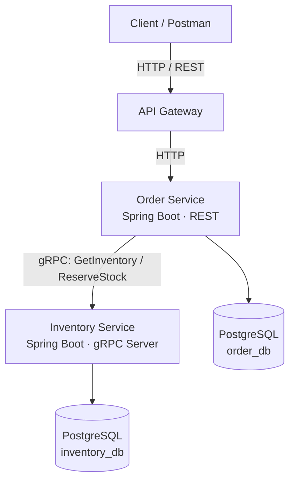
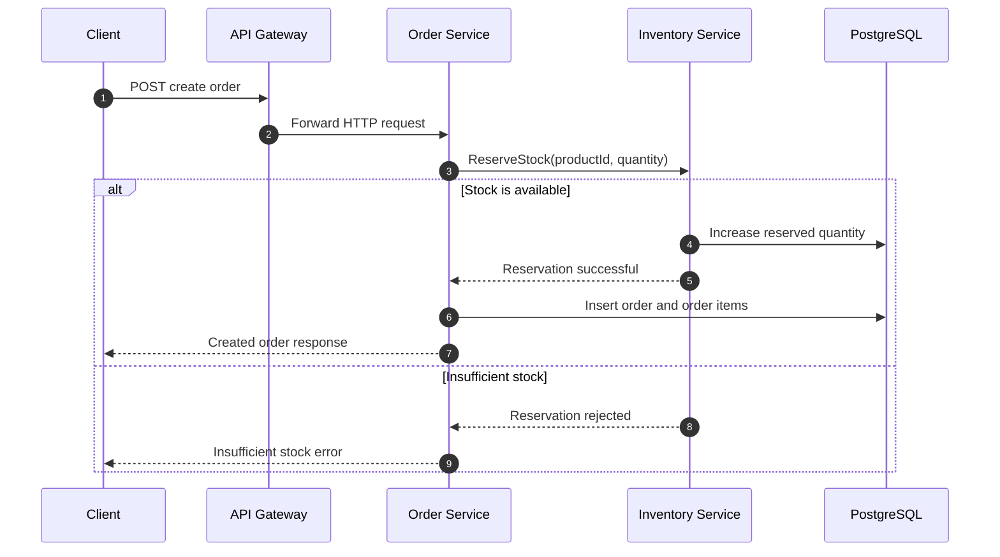

# SmartWareHouse

<p align="center">
  
</p>

<p align="center">
  A Spring Boot microservices project demonstrating order processing,
  inventory management, and real-time stock reservation with gRPC.
</p>

<p align="center">
  
  
  
  
  
</p>

## 1. Project overview

**SmartWareHouse** is a containerized warehouse-management example built around independently deployable services. It demonstrates how an order-processing service can communicate with an inventory service, reserve stock, and reject an order when there is not enough available inventory.

The project focuses on practical backend and distributed-systems concepts:

- Microservice separation and service-to-service communication.
- REST APIs for client-facing order operations.
- gRPC for communication between Order Service and Inventory Service.
- PostgreSQL persistence using Spring JDBC.
- Docker Compose for local multi-container deployment.
- Stock reservation and insufficient-stock validation.

## 2. Architecture

The diagram below shows the logical request flow. The API Gateway is the client entry point; the Order Service calls the Inventory Service over gRPC. Each service uses its own logical database.



### Order creation flow



> **Important:** A gRPC reservation and a PostgreSQL order insert are two separate service/database operations. A production system should also handle failures that occur after stock is reserved (for example, with a Saga/compensation strategy, idempotency, and retry-safe operations).

## 3. Services and responsibilities

| Component | Responsibility |
|---|---|
| API Gateway | Entry point for client HTTP requests and routing to backend services. |
| Order Service | Validates order requests, calculates totals, requests stock reservation, and persists orders and order items. |
| Inventory Service | Provides inventory queries and gRPC stock-reservation operations; tracks total, reserved, and available quantities. |
| Production Planning Service | Generates deterministic production plans from pending orders, BOMs, routings, work centers, employees and working calendars; reserves materials on confirmation. |
| PostgreSQL | Stores order, inventory and production-planning data in separate databases. |
| Docker Compose | Starts the application containers and database for local development. |

### Inventory calculation

The inventory response exposes the following values:

```text
available_quantity = quantity - reserved_quantity
```

For example, if total quantity is `20` and reserved quantity is `15`, available quantity is `5`. A request to reserve `6` should be rejected.

## 4. Technology stack

| Technology | What it does in this project |
|---|---|
| Java 17 | Application runtime and language. |
| Spring Boot 3.x | Creates the REST and gRPC service applications and manages configuration and dependency injection. |
| Spring JDBC / JdbcTemplate | Executes SQL and maps database rows to Java objects without using JPA. |
| PostgreSQL | Relational persistence for orders, order items, and inventory. |
| REST / HTTP | Client-facing API style for order operations. |
| gRPC | Efficient typed service-to-service communication between Order Service and Inventory Service. |
| Protocol Buffers | Defines gRPC service methods and request/response message structures in `.proto` files. |
| Docker | Packages each service and the database into containers. |
| Docker Compose | Configures and starts the local multi-container environment. |
| Postman / grpcurl | Useful tools for testing REST and gRPC endpoints. |

### Why use both REST and gRPC?

- **REST** is convenient for browser clients, Postman, and external integrations.
- **gRPC** provides a strongly typed contract generated from Protocol Buffers and is suitable for internal service-to-service calls.
- Using both demonstrates how a system can expose a familiar HTTP API while using gRPC internally.

## 5. Prerequisites

Install the following before starting:

1. **Docker Desktop** on Windows or Docker Engine plus the Docker Compose plugin on Linux.
2. **Git** to clone the repository.
3. **Postman** (optional) to test REST and gRPC requests.
4. **grpcurl** (optional) to test the gRPC server from a terminal.

You do not need to install Java or PostgreSQL locally if you run the complete stack through Docker Compose. Docker must be running before you execute Compose commands.

Check the installations:

```powershell
docker --version
docker compose version
git --version
```

## 6. Installation and startup with Docker

### Step 1 — Clone the repository

```powershell
git clone https://github.com/yongwang0705/SmartWareHouse.git
cd SmartWareHouse
```

### Step 2 — Configure environment variables

Check the repository for `.env.example` or the environment-variable section in `docker-compose.yml`. If an example file exists, copy it:

```powershell
Copy-Item .env.example .env
```

Edit `.env` and provide values matching your Compose configuration. For example:

```dotenv
POSTGRES_DB=order_db
POSTGRES_USER=scm_user
DB_PASSWORD=change_me

ORDER_DB_URL=jdbc:postgresql://postgres:5432/order_db
INVENTORY_DB_URL=jdbc:postgresql://postgres:5432/inventory_db
PRODUCTION_DB_URL=jdbc:postgresql://postgres:5432/production_db
```

The PostgreSQL container creates `inventory_db` and `production_db` on first
initialization through `docker/init-dbs.sh`. If you reuse a PostgreSQL volume
created before the Production Planning Service was added, the databases will
not exist yet. Either create them manually or reset the development volume with
`docker compose down -v` (this deletes local database data).

The example above illustrates the database credentials and Docker-internal JDBC URLs used by this project. Your Compose file may define additional variables or use separate database initialization settings; keep those names and values consistent. Do not commit real passwords or production secrets.

**Docker networking note:** containers should connect to PostgreSQL using the Compose service hostname (for example, `postgres:5432`) and to Inventory Service using its Compose hostname (for example, `inventory-service:9090`). Inside a container, `localhost` refers to that same container, not another service.

### Step 3 — Build and start all services

From the directory containing `docker-compose.yml`:

```powershell
docker compose up --build -d
```

This builds the application images (when build definitions are present), creates the network and containers, and starts the services in the background.

### Step 4 — Verify container status

```powershell
docker compose ps
```

All required services should show as running/healthy, depending on whether health checks are configured.

### Step 5 — View logs

```powershell
# All services
docker compose logs -f

# One service at a time
docker compose logs -f order-service
docker compose logs -f inventory-service
docker compose logs -f api-gateway
```

Use `Ctrl+C` to stop following logs; this does not stop the containers.

### Useful Docker commands

```powershell
# Stop and remove containers and the Compose network
docker compose down

# Stop containers without removing them
docker compose stop

# Start existing containers
docker compose start

# Rebuild and recreate only Order Service
docker compose up -d --build --no-deps order-service

# Rebuild and recreate only Inventory Service
docker compose up -d --build --no-deps inventory-service

# Follow Order Service logs
docker compose logs -f --tail=100 order-service
```

`docker compose down -v` also removes named volumes and can delete local database data. Use it only when you intentionally want to reset the database.

## 7. Local service endpoints

The following are the host ports used in the current development setup. If your `docker-compose.yml` changes, update this table to match its `ports` mappings.

| Component | Host address | Purpose |
|---|---|---|
| API Gateway | `http://localhost:8080` | Client HTTP entry point |
| Order Service | `http://localhost:8081` | Order REST API |
| Inventory Service | `http://localhost:8082` | Inventory HTTP endpoint, if enabled |
| Inventory gRPC | `localhost:9090` | Inventory gRPC server |
| Production Planning | `http://localhost:8083` | Production planning REST API |
| Production Planning gRPC | `localhost:9091` | PPS gRPC server port (reserved) |
| PostgreSQL | `localhost:5435` | Host access to PostgreSQL |

Within the Compose network, use service DNS names and container ports rather than host-mapped ports.

## 8. API and gRPC testing

### 8.1 Create an order using REST

Send a `POST` request to the order-creation endpoint exposed by your Order Service or API Gateway. The path below is an example; use the exact mapping declared by your controller and gateway configuration.

```http
POST http://localhost:8081/api/orders
Content-Type: application/json
```

Request body:

```json
{
  "customerId": 1001,
  "items": [
    {
      "productId": 101,
      "quantity": 2
    }
  ]
}
```

A successful response should contain the generated order ID, order status, total amount, and saved order items. The item ID should be populated from the database-generated value.

### 8.2 Query inventory using gRPC

If `grpcurl` is installed, run:

```powershell
grpcurl -plaintext -d "{\"productId\":101}" 127.0.0.1:9090 InventoryService/GetInventory
```

Example response:

```json
{
  "product_id": "101",
  "product_name": "Laptop",
  "quantity": 20,
  "reserved_quantity": 15,
  "available_quantity": 5
}
```

### 8.3 Test stock reservation directly

The following calls the Inventory Service directly. It is useful for testing the gRPC server independently of the Order Service:

```powershell
grpcurl -plaintext -d "{\"productId\":101,\"quantity\":2}" 127.0.0.1:9090 InventoryService/ReserveStock
```

Use this test carefully: a successful reservation changes inventory.

### 8.4 Test insufficient stock

If the inventory has `5` available units, submit an order for `6` units:

```json
{
  "customerId": 1001,
  "items": [
    {
      "productId": 101,
      "quantity": 6
    }
  ]
}
```

Expected behavior:

- Inventory Service rejects the reservation.
- Order Service reports an insufficient-stock error (for example, HTTP `409 Conflict` if configured).
- No order should be persisted for the rejected request.
- Inventory quantities should remain unchanged.

The exact HTTP status and error response depend on the exception handler configured in Order Service.

### 8.5 Production planning walkthrough

The Production Planning Service (PPS) owns `production_db` and never queries
`order_db` or `inventory_db` directly. It retrieves pending orders over gRPC
from Order Service and reads/reserves materials over gRPC from Inventory
Service.

On first start, PPS seeds a small, idempotent demonstration configuration
(work centers, employees, skills, shifts, BOMs and routings) so the walkthrough
below produces a real schedule. Replace or extend it through the configuration
endpoints. To disable the seed data, delete
`smartwarehouse-production-planning/src/main/resources/data.sql` before
building the image.

Create one or more orders (through the gateway or Order Service directly).
The `dueDate` and `priority` fields are optional; they default to seven days
out and `NORMAL`.

```http
POST http://localhost:8080/api/orders
Content-Type: application/json

{
  "customerId": 5001,
  "dueDate": "2026-11-20",
  "priority": "HIGH",
  "items": [
    { "productId": 101, "quantity": 30 }
  ]
}
```

Generate a draft plan. Generation only calculates and persists the schedule;
it does not reserve inventory or change order production status.

```http
POST http://localhost:8080/api/production/plans/generate
Content-Type: application/json

{
  "planningStart": "2026-11-13",
  "planningEnd": "2026-11-30",
  "algorithm": "PRIORITY_EARLIEST_DUE_DATE"
}
```

Response (abridged):

```json
{
  "planId": 1,
  "planNumber": "PLAN-2026-0001",
  "status": "DRAFT",
  "totalOrders": 1,
  "scheduledOrders": 1,
  "atRiskOrders": 0,
  "materialShortageOrders": 0,
  "capacityShortageOrders": 0
}
```

Inspect the plan, then confirm it. Confirmation revalidates inventory,
reserves all required materials atomically with the plan number as an
idempotent reservation reference, and updates order production status. If any
task has `MATERIAL_SHORTAGE` or `CAPACITY_SHORTAGE`, confirmation is rejected
with `409 Conflict` and the plan stays `DRAFT`.

```http
GET  http://localhost:8080/api/production/plans/1
POST http://localhost:8080/api/production/plans/1/confirm
```

Start and complete production tasks:

```http
POST http://localhost:8080/api/production/tasks/1/start
POST http://localhost:8080/api/production/tasks/1/complete
```

Cancelling a confirmed plan releases its material reservations before the
plan is marked `CANCELLED`. If the release call fails, the plan is not
cancelled and the API returns `409` so the reservation is not silently
abandoned.

```http
POST http://localhost:8080/api/production/plans/1/cancel
```

Configuration endpoints:

| Method | Endpoint | Description |
|---|---|---|
| GET/POST | `/api/production/work-centers` | List or create work centers |
| GET/POST | `/api/production/employees` | List or create employees |
| POST | `/api/production/employees/{id}/skills` | Assign a skill to an employee |
| POST | `/api/production/employees/{id}/shifts` | Configure an employee shift |
| GET/POST | `/api/production/employees/{id}/unavailability` | Read (`?from=&to=`) or create leave periods |
| GET/POST | `/api/production/routings` | List or create routings |
| POST | `/api/production/routings/{id}/operations` | Add an operation to a routing |
| GET/POST | `/api/production/bom` | Create BOM lines; `GET /bom/{productId}` reads them |
| GET/POST | `/api/production/working-calendar` | Read (`?from=&to=`) or upsert working days |
| GET | `/api/production/resources` | List resource assignments (`?planId=` optional) |

### 8.6 Production planning tests

```bash
cd smartwarehouse-production-planning
./mvnw test
```

`SchedulingEngineTest` covers priority ordering, due-date ordering, finished
goods allocation, material shortages, capacity shortages, skill matching,
double booking, work-center capacity, operation sequencing, due-date risk and
determinism.

## 9. Database concepts

The project separates order persistence from inventory persistence using two logical PostgreSQL databases:

- `order_db`: stores orders and their order items.
- `inventory_db`: stores product inventory, stock reservations and material reservations.
- `production_db`: stores production plans, tasks, BOMs, routings, work centers, employees and schedules.

A typical order has a one-to-many relationship with order items: one order can contain multiple products. Inventory tracks the total quantity and the quantity reserved for orders. The available quantity is derived from those values.

## 10. Troubleshooting

| Symptom | What to check |
|---|---|
| `Connection refused` from Order Service to Inventory Service | Confirm Inventory Service is running, listens on port `9090`, and the Order Service gRPC channel uses `inventory-service:9090` inside Docker. |
| gRPC HTTP/2 preface or TLS error | Ensure the client and server use matching TLS/plaintext settings. For a plaintext local server, use `grpcurl -plaintext`. |
| Database connection failure | Check PostgreSQL container status, credentials, database initialization, and Docker-internal JDBC host/port. |
| Port already allocated | Find the process using the host port or change the host-side port mapping in Compose. |
| Changes are not reflected | Rebuild and recreate the changed service with `docker compose up -d --build --no-deps <service-name>`. |
| Insufficient stock | Query inventory and compare `quantity`, `reserved_quantity`, and `available_quantity`. |

## 11. What this project demonstrates

By running and extending SmartWareHouse, you can practice:

- Designing a small microservices system.
- Building REST endpoints with Spring Boot.
- Defining gRPC contracts with Protocol Buffers.
- Implementing blocking gRPC clients and servers.
- Persisting data with PostgreSQL and JdbcTemplate.
- Handling database-generated identifiers.
- Validating stock before confirming an order.
- Containerizing services and coordinating them with Docker Compose.
- Diagnosing service discovery, port mapping, database, and gRPC connectivity issues.

## 12. Future improvements

Possible next steps for a more production-oriented implementation:

- Add authentication and authorization at the API Gateway.
- Add centralized configuration, health checks, and service observability.
- Add idempotency keys to prevent duplicate order submissions.
- Implement a Saga or compensating reservation operation for failures after stock reservation.
- Add integration tests using Testcontainers.
- Add CI pipelines to build, test, and publish service images.
- Add API documentation with OpenAPI and gRPC reflection.

## License

Add the license that applies to this repository before distributing the project.
